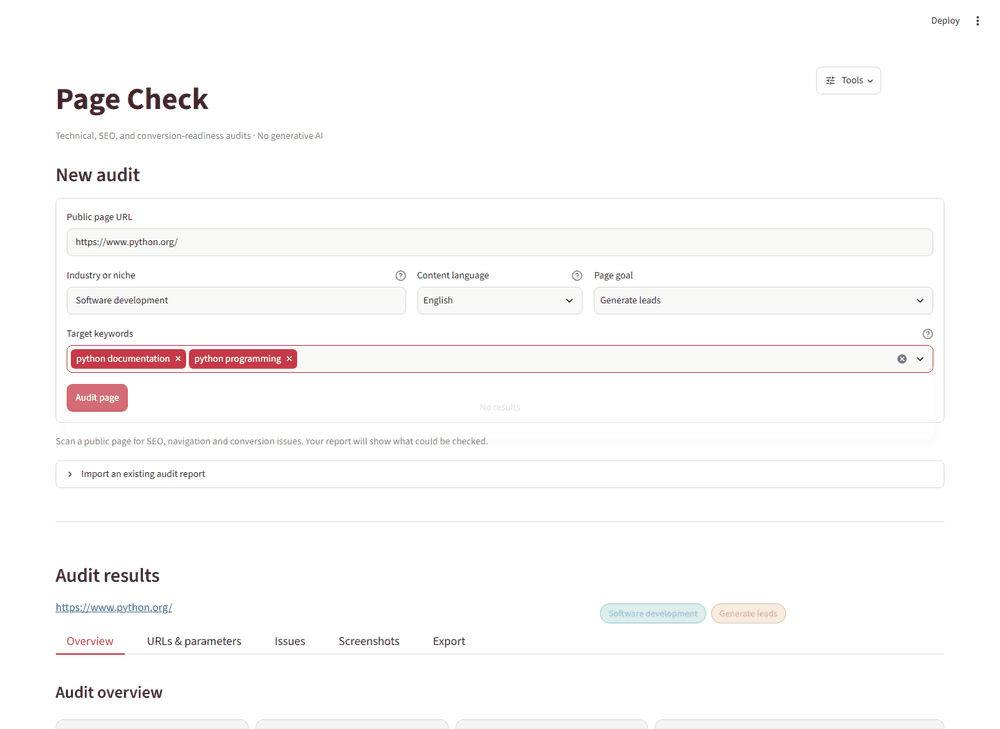
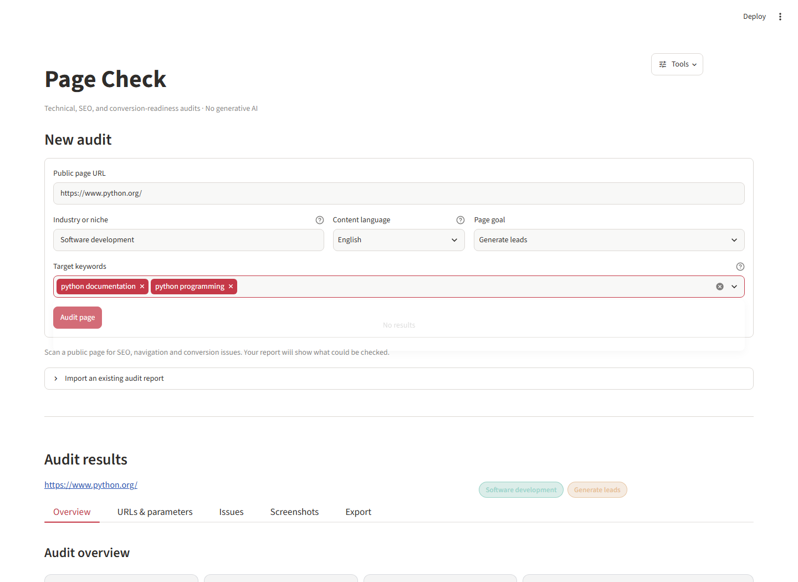
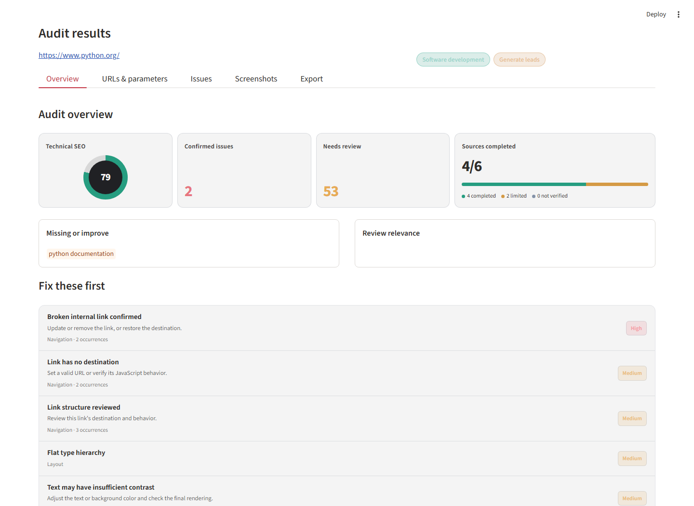
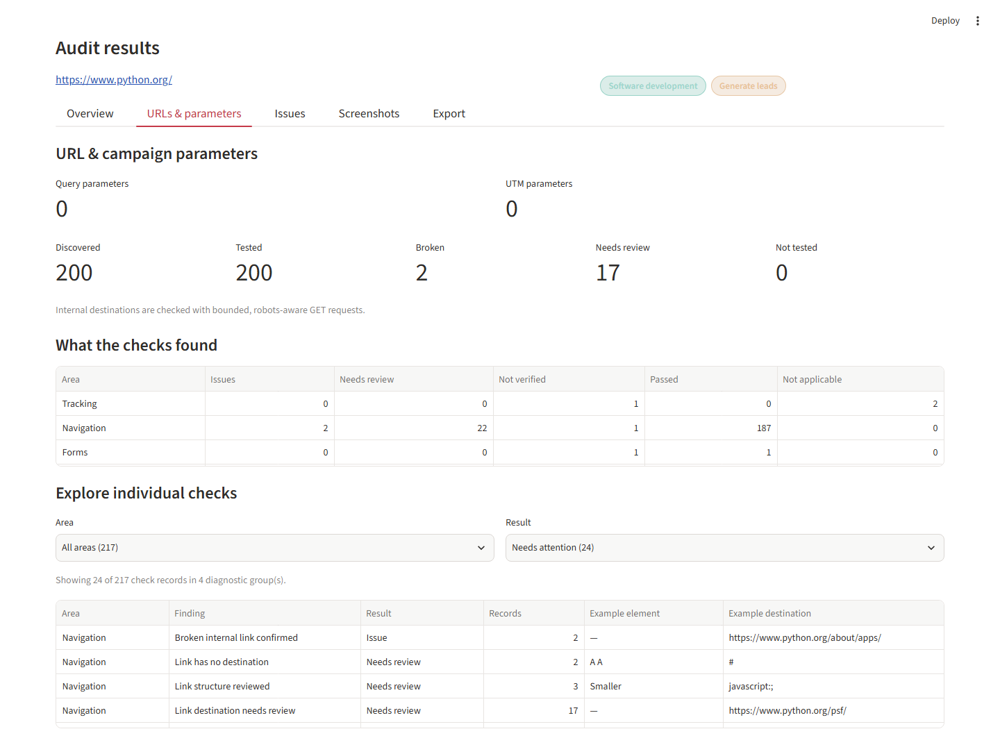
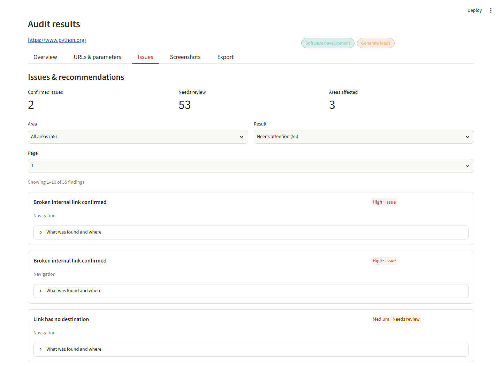
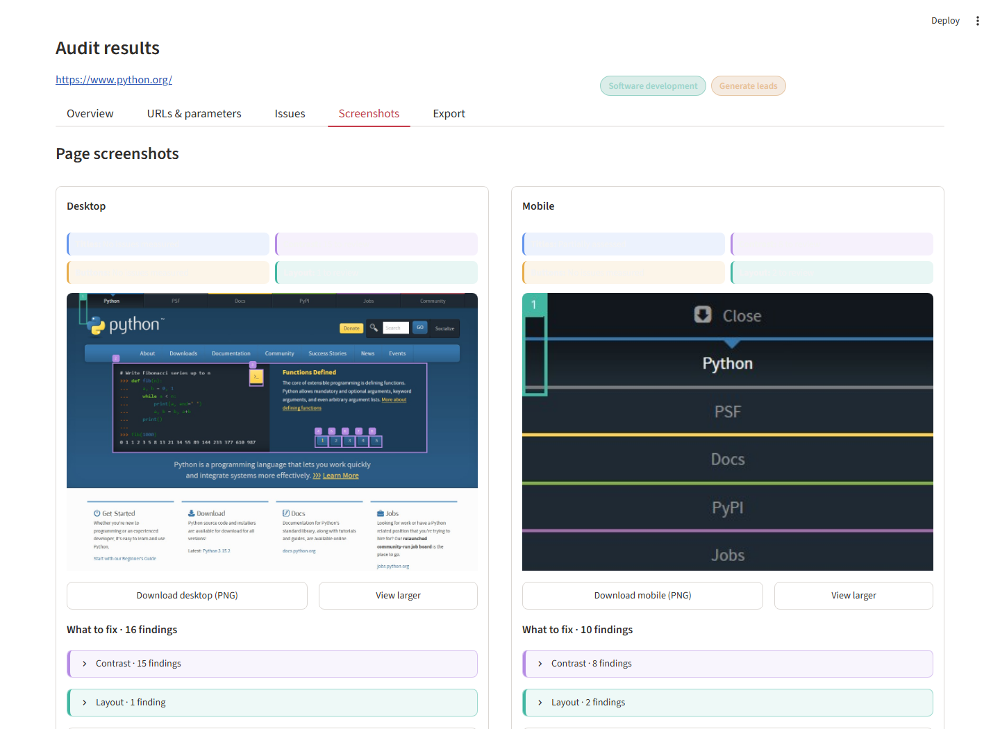

# Page Check


Page Check turns a public landing-page URL into an evidence-backed audit of technical SEO, content relevance, internal links, navigation, accessibility signals, design checks, and responsive rendering.

I built it for SEO, growth, marketing, and frontend work where a score alone is not enough: every important result needs an observable problem, location, evidence, and recommended action.

The application is intentionally **local, code-first, deterministic, and low-cost to operate**. Python rules and specialized libraries handle repeatable checks without consuming LLM tokens on every audit, while the architecture keeps results inspectable and protects the machine running the scan.

## Demo

<p align="center">
  
</p>

<p align="center">
  <em><strong>Demo.</strong> A real local audit of Python.org with an explicit niche, language, goal, and target keywords.</em>
</p>

## The Problem

Reviewing a landing page manually means inspecting metadata, headings, keyword placement, internal links, redirects, anchors, accessibility signals, responsive rendering, and conversion elements across several tools. The reviewer must then reconcile different outputs and translate them into work that SEO, content, design, and frontend teams can actually use.

The result is often fragmented: a score has no visible evidence, unchecked URLs look like failures, recommendations are generic, and browser-based tools can access destinations outside the intended audit boundary.

This also creates an operational cost problem. Stable checks such as title presence, heading structure, keyword placement, redirects, broken links, and missing attributes do not require a generative model for every execution. Paying with tokens or usage credits each time makes frequent audits harder to standardize and unnecessarily expensive to repeat across pages and campaigns.

## The Solution

I built Page Check to move those repeatable decisions into a bounded local workflow that:

1. Validates and fetches a public URL through a protected transport.
2. Evaluates technical SEO with explicit weighted rules.
3. Reviews content against the declared niche, language, and target keywords.
4. Crawls eligible same-host links and records status, redirects, anchors, and source elements.
5. Renders guarded desktop and mobile views with JavaScript.
6. Runs static axe-core and Impeccable checks on sanitized HTML.
7. Consolidates evidence into Overview, URLs, Issues, Screenshots, and Export views.
8. Persists reports locally and exports JSON, CSV, and ZIP artifacts.

The result is a reusable report that connects technical evidence to action without inventing findings. Missing coverage remains explicit instead of being converted into a failure, and the same deterministic rules can be run repeatedly without a per-audit model dependency.

## Application Overview

<p align="center">
  
</p>

<p align="center">
  <em><strong>Figure 1.</strong> Local audit configuration and the resulting report workspace.</em>
</p>

## Key Features

- **Deterministic technical SEO score:** weighted checks for title, meta description, H1, heading order, canonical URL, `noindex`, and image alternative text.
- **Context-aware content review:** checks exact single- and multi-word keywords against the selected language, niche, title, description, headings, main content, anchors, and image alt text.
- **Selective Scrapling integration:** uses `scrapling.Selector` only to parse HTML already retrieved by Page Check's guarded GET transport.
- **Bounded internal crawler:** verifies up to 200 eligible same-host links by default while page and depth limits control further discovery rather than prematurely stopping verification.
- **Actionable link evidence:** records the problem, result, source element, destination, HTTP status, redirect chain, final URL, and anchor/fragment evidence.
- **JavaScript rendering:** produces guarded desktop and mobile screenshots without permitting POST, WebSocket, downloads, Service Workers, or unrestricted browser networking.
- **Accessibility and design signals:** runs axe-core and Impeccable against a sanitized static snapshot and labels their actual coverage.
- **Evidence-first reports:** separates confirmed issues, human-review items, passed checks, non-applicable rules, and checks that could not be verified.
- **Local history and exports:** stores audit reports in SQLite and produces JSON, CSV, and ZIP packages with HTML and screenshots when available.

## Architecture & Engineering Decisions

```text
Streamlit report UI
        |
        v
FastAPI local API
        |
        v
Audit orchestration and consolidation
   /          |            \
  v           v             v
Guarded HTTP  Deterministic  Guarded Playwright
transport     audit rules    rendering
  |              |              |
  v              v              v
Scrapling      SEO/content     Desktop/mobile
parser         link/UX rules   evidence
   \             |             /
    \            v            /
     ----> normalized findings
                 |
                 v
       SQLite history + exports
```

### Bounded crawling without arbitrary cutoffs

The crawler separates **verification** from **expansion**. `max_pages` and `max_depth` limit how many fetched HTML pages can discover more links; they do not discard already discovered eligible destinations. Verification remains sequential, GET-only, robots-aware, same-host, loop-protected, and subject to request and global timeouts.

| Control | Default | Local environment variable |
|---|---:|---|
| HTML pages expanded | 20 | `PAGECHECK_CRAWL_MAX_PAGES` |
| Crawl depth | 2 | `PAGECHECK_CRAWL_MAX_DEPTH` |
| Links verified | 200 | `PAGECHECK_CRAWL_MAX_LINKS` |
| Crawl time budget | 90 seconds | `PAGECHECK_CRAWL_TIME_BUDGET_SECONDS` |
| Concurrent requests | 1 | Fixed safety boundary |

### Protected public-page access

- HTTP and HTTPS public destinations only.
- Initial URLs, DNS results, connections, and redirects are checked against private, loopback, link-local, and metadata ranges.
- Links outside the audited host are inventoried but not requested.
- Forms are not submitted and the crawler never performs write actions.
- Browser traffic is routed through the guarded fetch path; direct sockets and unsafe request methods remain blocked.
- `robots.txt`, bounded bodies, per-request timeouts, cancellation, and loop prevention remain active.

### Deterministic, low-token operation

Deterministic code handles retrieval, parsing, scoring, keyword checks, link validation, grouping, and rule-specific recommendations. Specialized engines are used only where they add measurable evidence. This keeps each result inspectable, supports repeatable daily use, and keeps recurring token and model costs out of the audit path.

## Tech Stack

| Layer | Technology |
|---|---|
| Application language | Python 3.11+ |
| Package management | uv |
| Local API | FastAPI and Uvicorn |
| Report interface | Streamlit |
| HTML parsing | BeautifulSoup and selective Scrapling `Selector` |
| HTTP client | HTTPX through Page Check's protected transport |
| Browser rendering | Playwright with Chromium |
| SEO and content analysis | Page Check deterministic rules plus authorized jev-seo rule concepts |
| Accessibility | axe-core |
| Static design checks | Impeccable |
| Local persistence | SQLite |
| Export processing | Python and pandas |
| Automated validation | pytest and Ruff |

## Screenshots & Reports

### SEO analysis

<p align="center"></p>

The Overview keeps the technical score separate from content guidance. Keyword chips are produced from recorded checks, and priority labels are limited to High, Medium, and Low.

### URLs and internal links

<p align="center"></p>

The recorded Python.org audit discovered 200 eligible internal URLs and tested all 200. Broken links and redirects remain visible as separate outcomes instead of being hidden inside a generic score.

### Issues and recommendations

<p align="center"></p>

Each finding can expose the observed element, location, evidence, and a rule-specific recommendation.

### Desktop and mobile evidence

<p align="center"></p>

Screenshots use the real rendered page and preserve the approved report design. Rendering limits are shown when a site cannot be fully reproduced within the guarded browser policy.

## Repository Structure

```text
.
├── docs/                          # PRD, architecture, contracts, and rule documentation
├── img/                           # Real README screenshots and demo GIF
├── scripts/                       # Local probes and validation utilities
├── src/pagecheck/
│   ├── acquisition/               # Protected HTTP, Scrapling adapter, and browser capture
│   ├── api/                       # FastAPI routes and schemas
│   ├── application/use_cases/     # Audit, crawl, engine, and consolidation orchestration
│   ├── audits/                    # SEO, content, navigation, layout, image, and form rules
│   ├── common/security/           # URL admission, network boundaries, and worker isolation
│   ├── integrations/              # axe-core and Impeccable adapters
│   ├── persistence/               # Local SQLite history
│   ├── reporting/                 # Normalization, evidence, and exports
│   └── ui/                        # Streamlit application and report components
├── tests/                         # Unit, integration, and end-to-end tests
├── main.py                        # FastAPI entry point
├── streamlit_app.py               # Streamlit entry point
├── pyproject.toml
└── THIRD_PARTY_NOTICES.md         # License attribution for incorporated third-party work
```

Local databases, user-generated reports, logs, caches, credentials, `.venv`, and `node_modules` are excluded from Git.

## Installation & Usage

### Requirements

- Windows PowerShell
- Python 3.11 or newer
- [uv](https://docs.astral.sh/uv/)
- Node.js and npm

Install the locked dependencies and Chromium:

```powershell
uv sync
npm ci
uv run playwright install chromium
```

Run the API from the repository root:

```powershell
$env:PAGECHECK_ENV="local"
$env:PAGECHECK_ALLOW_LIVE_FETCH="1"
$env:PAGECHECK_ALLOW_LIVE_BROWSER="1"
$env:PAGECHECK_ALLOW_LOCAL_STATIC_ENGINES="1"
uv run uvicorn main:app --host 127.0.0.1 --port 8765
```

In a second PowerShell terminal, run the interface:

```powershell
$env:PAGECHECK_API_URL="http://127.0.0.1:8765"
uv run streamlit run streamlit_app.py --server.address 127.0.0.1 --server.port 8501
```

Open `http://127.0.0.1:8501`. Both services bind to loopback and stop with `Ctrl+C`.

Run the test suite:

```powershell
uv run pytest -q
```

## What This Project Demonstrates

Page Check demonstrates how I approach a complete engineering problem rather than a single interface or isolated script:

- **Secure public-page acquisition:** URL admission, DNS and redirect validation, SSRF protection, bounded bodies, timeouts, robots handling, and guarded browser requests.
- **Modular Python architecture:** clear separation between acquisition, audit rules, orchestration, consolidation, persistence, exports, API routes, and presentation.
- **Deterministic product logic:** weighted SEO scoring, niche/language/keyword checks, cross-page duplicate rules, and evidence-based recommendations without runtime model calls.
- **Crawler design:** progressive same-host discovery with separate expansion and verification limits, controlled concurrency, fragment checks, redirect evidence, and loop protection.
- **Browser and specialist-engine integration:** Playwright desktop/mobile evidence plus sanitized axe-core and Impeccable execution with explicit coverage boundaries.
- **Traceable reporting:** normalized findings connect each issue to its source, location, observed value, destination, and recommended correction.
- **Local-first delivery:** Streamlit, FastAPI, SQLite history, and JSON/CSV/ZIP exports run without hosted infrastructure.
- **Verification discipline:** 594 automated tests, controlled 200-link coverage, a real public-site audit, security scanning, and real README media.
- **Cost-aware engineering:** stable analysis stays in code so repeated audits do not create unnecessary model-token consumption.

## Tests, Limitations & Credits

### Validation

The final validation includes **594 passing automated tests**, targeted crawler and security tests, a controlled 200-link crawler fixture, and a real local Python.org flow through the API and Streamlit UI.

The real audit recorded:

- 200 internal links discovered and 200 tested;
- 181 valid destinations, 2 broken destinations, 17 redirects/review outcomes, and 0 untested links;
- evidence-based SEO keyword guidance;
- desktop and mobile screenshots;
- axe-core and Impeccable static results;
- local SQLite persistence and JSON, CSV, and ZIP exports.

### Limitations

- Page Check does not measure Google rankings, search volume, real conversions, field Core Web Vitals, or complete WCAG conformance.
- External links are listed but not requested.
- The crawler is bounded and may leave URLs untested when robots rules, time, page/link limits, cancellation, or a third-party restriction legitimately prevents verification.
- Browser rendering does not click through application flows, authenticate, solve CAPTCHAs, submit forms, or allow unrestricted third-party resources.
- Static axe-core and Impeccable checks supplement, but do not replace, expert accessibility and design review.
- Semantic relevance is based on declared keywords and deterministic evidence; the application does not invent “bad keywords” or infer search intent with AI.

### Credits and license notices

- [Scrapling](https://github.com/D4Vinci/Scrapling) — BSD 3-Clause licensed `Selector` parser used over HTML already fetched by Page Check. Its fetchers, proxy, stealth, MCP, and AI features are not used.
- [jev-seo](https://github.com/AgriciDaniel/jev-seo) — MIT licensed concepts adapted into deterministic cross-page duplicate title and description rules.
- [Playwright](https://playwright.dev/), [axe-core](https://github.com/dequelabs/axe-core), and [Impeccable](https://github.com/peterbe/impeccable) provide the specialized browser, accessibility, and static design engines used within the documented boundaries.

See [third-party licenses and attribution](THIRD_PARTY_NOTICES.md) for the incorporated work that must retain credit, and [the validated product requirements](docs/PRD.md) for the implemented scope.
